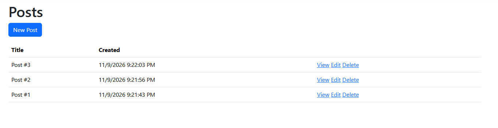

# EF Core Blog

This program allows the user to make posts to the blog where they will later be stored in a .db file. These posts can be viewed, edited, and deleted if the user would like to.

# How to Run

After building the program, simple execute the .exe file and you will be able to access the website using the provided local URL.

# Images

